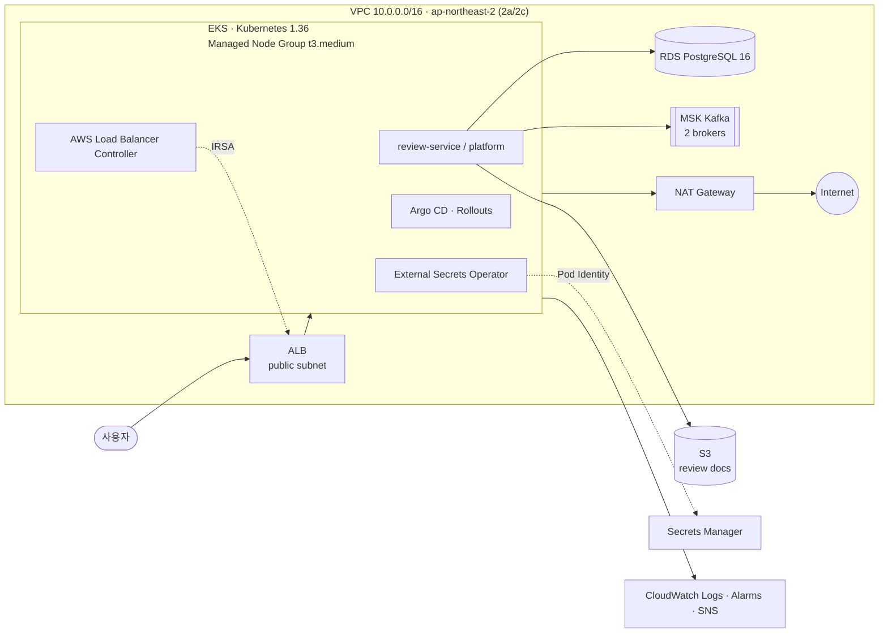

# oneaction-infra

oneaction 서비스의 AWS 인프라를 정의한 Terraform 코드입니다. 네트워크부터 EKS, 데이터 계층, 시크릿 동기화까지 스택 단위로 나눠 관리하며, 애플리케이션 배포는 별도 GitOps 저장소의 Argo CD가 담당합니다.

> 공개 저장소입니다. AWS 계정 ID는 실제 팀 계정 `974402993422`(t3underline)로 맞췄습니다. Secret ARN 처럼 리소스를 만든 뒤에 정해지는 값은 아직 예시값이고, 운영 기록 문서는 제외했습니다.

## 아키텍처



## 스택 구성

각 스택은 독립된 Terraform 상태(`dev/<stack>/terraform.tfstate`)를 가지며, 앞 스택의 output을 `terraform_remote_state`로 참조합니다.

| 순서 | 스택 | 주요 리소스 |
| --- | --- | --- |
| 1 | [`network`](infra/network) | VPC, public·EKS·data 서브넷(2 AZ), NAT Gateway, S3 Gateway Endpoint, ALB·RDS·노드 보안그룹 |
| 2 | [`storage`](infra/storage) | 리뷰 문서 버킷(버전 관리·암호화), 로그 버킷(수명 주기), 퍼블릭 접근 차단 |
| 3 | [`dns`](infra/dns) | Route 53 호스팅 영역, ACM 인증서, CAA 레코드, 쿼리 로그 |
| 4 | [`database`](infra/database) | RDS PostgreSQL 16 (`db.t4g.micro`, 암호화, 마스터 비밀번호는 Secrets Manager 관리) |
| 5 | [`alb`](infra/alb) | ALB, HTTP/HTTPS 리스너, 플랫폼 대상 그룹 |
| 6 | [`observability`](infra/observability) | VPC Flow Logs, EKS 로그 그룹, RDS·ALB·NAT 알람, SNS 알림 |
| 7 | [`eks`](infra/eks) | EKS 클러스터, Launch Template 기반 Node Group, OIDC, VPC CNI 전용 IRSA, Access Entry |
| 8 | [`eks-lbc`](infra/eks-lbc) | AWS Load Balancer Controller용 IRSA 역할·정책, Helm values |
| 9 | [`eks-eso`](infra/eks-eso) | External Secrets Operator용 Pod Identity, Secret별 최소 읽기 정책 |
| 10 | [`msk`](infra/msk) | MSK Kafka 클러스터(`kafka.t3.small` × 2), EKS 서브넷에서만 허용하는 보안그룹 |
| 11 | [`tailscale`](infra/tailscale) | Tailscale 서브넷 라우터(`t4g.micro`, EKS private 서브넷). 온프렘 k3s 가 tailnet 으로 RDS·MSK 에 닿는 경로 |
| 12 | [`oneport-platform`](infra/oneport-platform) | Oneport 플랫폼 서버(도쿄 `t3.small`, 고정 IP, 보안그룹)와 서버·배포 IAM 역할. `eks`가 이 스택의 고정 IP를 API 허용 목록에 더한다 |

## 설계 포인트

- **스택 분리**: 변경 범위와 장애 영향을 줄이기 위해 리소스 수명 주기별로 상태를 나눴습니다. EKS 애드온(LBC, ESO)도 클러스터 스택과 분리했습니다.
- **최소 권한**: LBC는 IRSA, ESO는 EKS Pod Identity를 사용하고 읽을 수 있는 Secret을 ARN 단위로 제한합니다. Argo CD Notifications도 전용 역할을 따로 둡니다.
- **시크릿은 코드 밖에**: RDS 비밀번호, GitOps 토큰, API 키는 Secrets Manager에만 저장하고 ESO가 Kubernetes Secret으로 동기화합니다. Terraform은 Secret 메타데이터만 조회합니다.
- **네트워크 격리**: RDS와 MSK는 data 서브넷에 두고, EKS 서브넷 CIDR에서만 접근을 허용합니다. EKS API의 퍼블릭 엔드포인트는 `/32` allowlist로 제한합니다.
- **검증 자동화**: 스택마다 `terraform plan` JSON과 Helm 렌더 결과를 검사하는 스크립트(`scripts/check_*.py`, `Test-*.ps1`)를 둬서 계정·리전·권한 범위가 의도와 다르면 적용 전에 실패하도록 했습니다.

## 실행 방법

사전 요구사항: Terraform 1.5.7, AWS CLI v2, (EKS 애드온 설치 시) kubectl, Helm

```bash
# 1. 상태 저장용 S3 버킷·DynamoDB 잠금 테이블 이름을 infra/backend.hcl에 맞게 수정
# 2. 스택 순서대로 실행
cd infra/network
terraform init -backend-config=../backend.hcl
terraform plan -out=tfplan
terraform apply tfplan
```

EKS 관련 스택의 상세 절차와 변수는 각 디렉터리의 README를 참고하세요.

- [infra/README.md](infra/README.md) — 공통 전제와 적용 순서
- [infra/eks/README.md](infra/eks/README.md) — 클러스터 구성과 선택 근거
- [infra/eks-lbc/README.md](infra/eks-lbc/README.md) — Load Balancer Controller 설치
- [infra/eks-eso/README.md](infra/eks-eso/README.md) — 시크릿 동기화 구성

## 기술 스택

Terraform 1.5.7 · AWS provider 5.x · Amazon EKS · RDS for PostgreSQL · Amazon MSK · ALB · Route 53 · ACM · S3 · Secrets Manager · CloudWatch · External Secrets Operator · AWS Load Balancer Controller · Argo CD

## 현재 작업 환경과 미확인 입력

Notifications manifest의 source pin은 `SoftBankHackathon2026/gitops`의 확인한 커밋으로 갱신했고 파일 hash와 검증 코드도 맞췄다.

2026-11-04: 계정 ID와 상태 버킷은 실제 값(`974402993422`, `oneaction-tfstate-974402993422`)으로 맞췄다. 계정은 `hackerthon` SSO 프로필의 로그인 세션으로 확인했다. 아래 값은 리소스를 만든 뒤에야 정해지므로 아직 예시값이다.

- `infra/eks/example.tfvars` 의 관리자 IAM 역할 ARN (SSO 역할 경로 포함)
- `infra/eks-eso` 의 Secret ARN 기본값과 검증 스크립트 상수 (`...-AbCdEf`, `...-GhIjKl`)

실제 환경 준비에는 다음 입력이 필요하다.

1. 사용할 AWS 프로필과 STS 계정 확인.
2. 이미 존재하거나 별도로 준비한 Terraform 상태 버킷·잠금 테이블 이름과 권한.
3. 현재 네트워크·EKS·RDS·MSK 상태 및 remote-state output.
4. 실제 Secrets Manager ARN과 필요한 키 접근 권한. 비밀값을 코드에 기록하지 않는다.

로그인과 조회 후 해당 스택·검증 스크립트·예제 설정의 계정 및 리소스 참조를 함께 맞춘다. 이번 변경은 Terraform apply나 상태 이전을 수행하지 않았다. 공유 MSK의 기본 파티션 수는 유지하고, CDC 데이터 토픽은 gitops의 `scripts/create-migration-topic.sh`로 별도 생성·검증한다.

## GCP 대응 환경

- 기존 AWS 구성은 유지하고 GCP 진입점은 별도로 추가했습니다.
- [GCP 구성·적용 순서·AWS와의 차이](infra/gcp/README.md)에서 확인합니다.
- 프로젝트·리전·환경을 변수로 설정하며 상태는 Cloud Storage에 별도로 저장합니다.
- 실제 클라우드 적용과 데이터 이전은 수행하지 않았습니다.
